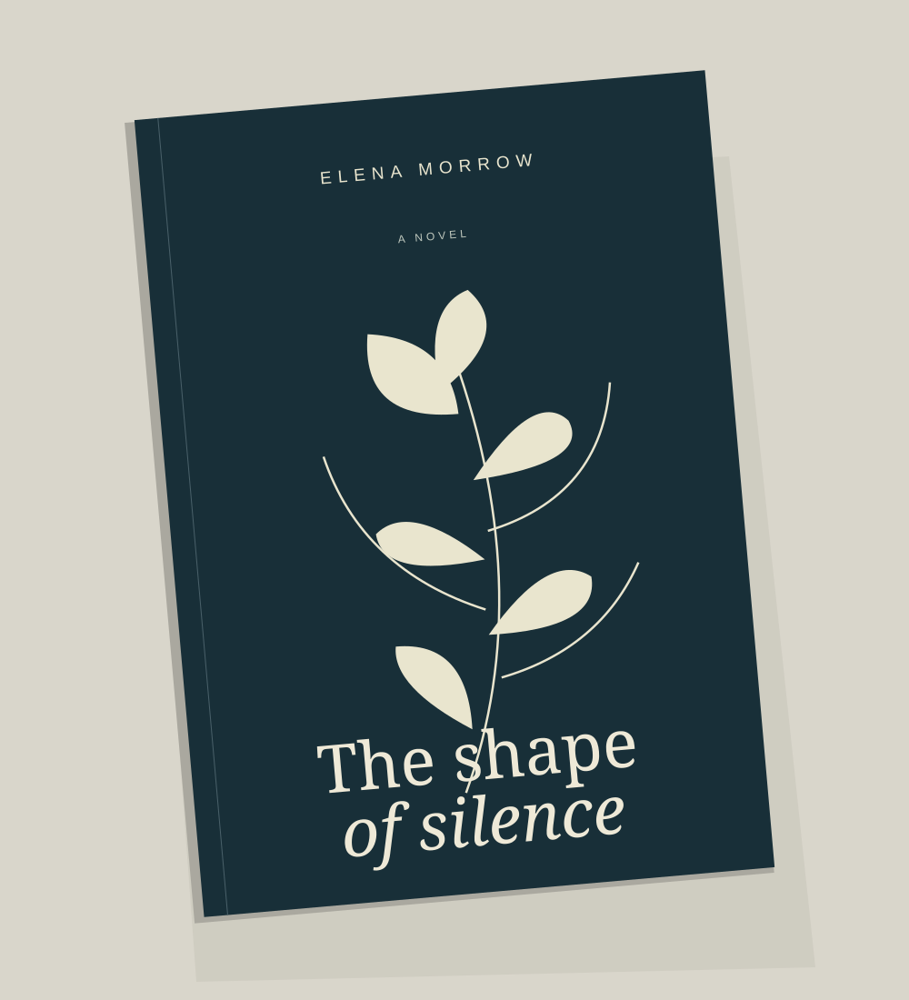

## title.en

The quiet atlas

## title.ru

Тихий атлас

## direction.en

Book cover · Travel essays

## direction.ru

Книжная обложка · Путевые эссе

## description.en

A cover for an imagined collection of travel essays. The project explores how **colour and rhythm** can evoke a place without showing it literally.

This is a second paragraph. You can add as much text as the project needs.

## description.ru

Обложка вымышленного сборника путевых эссе. Проект исследует, как **цвет и ритм** передают ощущение места без буквального изображения.

Это второй абзац. Описание может быть любой длины.

## concept.en

A restrained palette and an expressive silhouette connect the cover to the inner pages.

- Cover design
- Typography
- Endpaper illustration

## concept.ru

Сдержанная палитра и выразительный силуэт связывают обложку с внутренними страницами.

- Дизайн обложки
- Типографика
- Иллюстрация для форзаца

## status.en

Personal concept

## status.ru

Авторская концепция

## gallery.en

### Details

Add more images here, each separated by a blank line. Both local files and HTTPS image links are supported.

## gallery.ru

### Детали

Добавьте здесь другие изображения, разделяя их пустой строкой. Поддерживаются файлы из папки проекта и HTTPS-ссылки на изображения.
