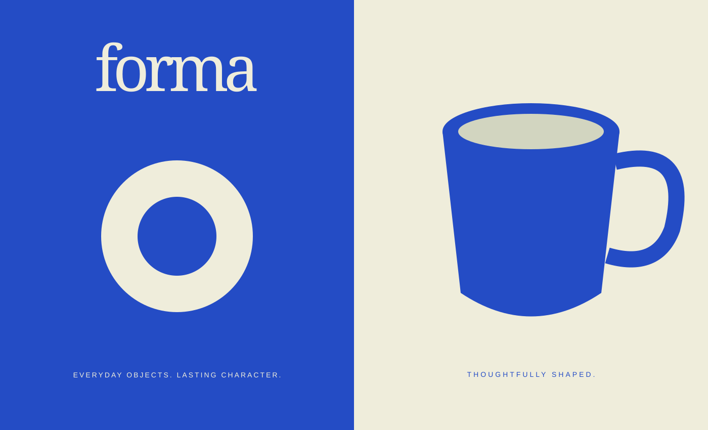

## title.en

Forma — everyday objects

## title.ru

Forma — повседневные объекты

## direction.en

Visual identity · Concept brand

## direction.ru

Айдентика · Концептуальный бренд

## description.en

A visual identity for an imagined independent ceramics studio. The idea celebrates useful objects with character: imperfect, tactile and made to be kept.

## description.ru

Визуальная айдентика вымышленной независимой керамической мастерской. В центре идеи — полезные предметы с характером: тактильные, несовершенные и созданные надолго.

## concept.en

An expressive wordmark, a cobalt-and-cream palette and a simple system of circular forms connect packaging, printed matter and the objects themselves.

## concept.ru

Выразительный логотип, кобальтово-кремовая палитра и система круговых форм связывают упаковку, печатные материалы и сами предметы.

## status.en

Self-initiated · Concept

## status.ru

Авторский · Концепция

## gallery.en

## gallery.ru

