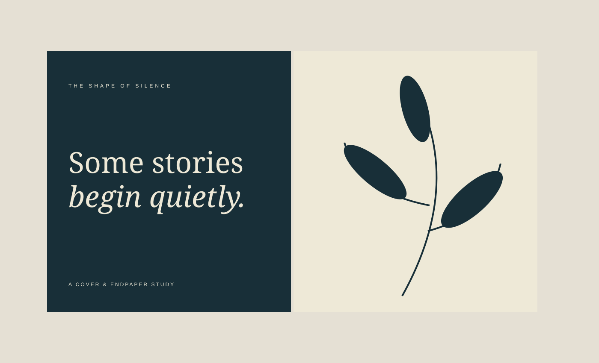

## title.en

The shape of silence

## title.ru

Форма тишины

## direction.en

Book cover · Literary fiction

## direction.ru

Книжная обложка · Художественная проза

## description.en

An imagined novel about memory, distance and the things we leave unsaid. A single botanical silhouette becomes both a landscape and a space for reflection.

## description.ru

Обложка вымышленного романа о памяти, расстоянии и невысказанном. Растительный силуэт становится одновременно пейзажем и пространством для размышления.

## concept.en

The restrained palette pairs midnight blue with warm ivory. Oversized typography and a delicate organic form create a quiet tension between presence and absence.

## concept.ru

Сдержанная палитра объединяет глубокий синий и тёплый цвет слоновой кости. Крупная типографика и тонкая органическая форма создают напряжение между присутствием и отсутствием.

## status.en

Self-initiated · Concept

## status.ru

Авторский · Концепция

## gallery.en

## gallery.ru

